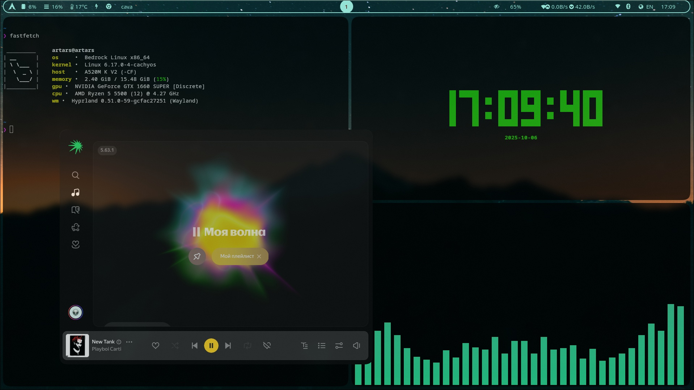

# Hyprland-Dots

Hyprland dotfiles on the **Lua** config backend, targeting **0.56.2** (also
runs on git/`main`).



---

## Requirements

**Hyprland ≥ 0.55.** Lua configs do not exist before that. Check with:

```sh
hyprctl version
```

If you are on 0.54 or older, this repo will not load — Hyprland falls back to
`hyprland.conf`, finds none, and generates a default.

Packages used by this config:

```
hyprland hyprpaper hyprsunset hyprshot waybar wofi kitty thunar dunst
wireplumber brightnessctl playerctl cava fastfetch
```

Optional: `hyprland-guiutils` (permission prompts), `wlogout`, `swaync`,
`pavucontrol`, `blueberry`, `nm-applet`.

## Install

```sh
git clone https://github.com/llebedev/Hyprland-Dots
cd Hyprland-Dots
./install.sh
```

`install.sh` backs up anything it would overwrite into
`~/.config/<app>.bak.<timestamp>` and then symlinks. Pass `--copy` to copy
instead of symlink, `--dry-run` to see what it would do.

Manual install is just:

```sh
cp -r .config/* ~/.config/
```

Then put a wallpaper at `~/wallpaper.jpg` (or edit `hyprpaper.conf`) and
restart Hyprland.

> Hyprland picks `hyprland.lua` over `hyprland.conf` **once, at startup**.
> If you are switching from a `.conf` setup, a full restart is required —
> `hyprctl reload` will not do it.

## Checking the config before you reload

```sh
lua tools/check.lua .config/hypr
```

This mocks the `hl` API and runs the whole config outside Hyprland. It
catches unknown animation leaves, undefined beziers, invalid leaf/style
combinations, `damping` vs `dampening`, rules with no effects, and
dispatcher tables that are built but never dispatched (the classic silent
no-op). Needs `lua5.4`.

Worth doing, because a runtime error aborts the Lua file it occurs in — a
typo above your binds means none of them register.

## Layout

```
.config/hypr/
├── hyprland.lua          entry point
├── conf/
│   ├── env.lua           environment variables
│   ├── programs.lua      terminal / file manager / launcher
│   ├── monitors.lua      display setup
│   ├── looks.lua         gaps, blur, rounding, opacity, misc
│   ├── animations.lua    curves + animation tree
│   ├── input.lua         keyboard, touchpad, gestures
│   ├── rules.lua         window + layer rules
│   ├── workspaces.lua    workspace rules
│   ├── binds.lua         keybinds
│   ├── autostart.lua     startup programs
│   └── permissions.lua   opt-in, commented out of hyprland.lua
├── hyprpaper.conf
└── hyprsunset.conf
```

Split on purpose: each `require()` is its own Lua scope, so a mistake in one
file cannot take the others down with it.

For machine-specific tweaks create `conf/local.lua`. It is gitignored and
loaded last, so it overrides everything.

## Keybinds

`SUPER` is the modifier.

| Keys | Action |
|---|---|
| `SUPER + Return` | Terminal |
| `SUPER + E` | File manager |
| `SUPER + R` | App launcher |
| `SUPER + Q` | Close window |
| `SUPER + M` | Exit Hyprland |
| `SUPER + V` | Toggle floating |
| `SUPER + P` | Toggle pseudotile |
| `SUPER + J` | Toggle split direction |
| `SUPER + ←↑↓→` | Move focus |
| `SUPER + 1..0` | Switch workspace |
| `SUPER + SHIFT + 1..0` | Move window to workspace |
| `SUPER + scroll` | Cycle workspaces |
| `SUPER + LMB` drag | Move window |
| `SUPER + RMB` drag | Resize window |
| `SUPER + SHIFT + S` | Screenshot region → clipboard |
| `SUPER + S` | Toggle scratchpad |
| `SUPER + CTRL + S` | Send window to scratchpad |

Media and brightness keys work on the lock screen. `hyprctl binds` lists
everything with descriptions.

Gestures: 3-finger swipe moves a window, 4-finger horizontal changes
workspace.

## Editor autocomplete

`.vscode/settings.json` points the Lua LSP at Hyprland's stubs, which gives
you completion and type warnings for the whole `hl.*` API:

```json
{
  "Lua.workspace.library": ["/usr/share/hypr/stubs"],
  "Lua.diagnostics.globals": ["hl"]
}
```

Neovim with `lua_ls` wants the same two values in its settings.

## Customising

**Monitor.** `conf/monitors.lua`. The explicit rule is for `DP-1`; the
wildcard below it covers everything else with `mode = "highrr"`, so these
dotfiles work unchanged on a different machine. Get output names from
`hyprctl monitors`.

**Programs.** `conf/programs.lua` — one table, used by both binds and
autostart.

**Wallpaper.** `hyprpaper.conf`. Point `path` at a directory with
`order = random` and a `timeout` to rotate.

**Colours.** Border gradient in `conf/looks.lua`; waybar palette in
`.config/waybar/mocha.css`.

## Documentation

- **[CHANGELOG.md](CHANGELOG.md)** — everything that changed from the
  hyprlang version, and why.
- **[KNOWN-ISSUES.md](KNOWN-ISSUES.md)** — 23 traps people hit on 0.55/0.56
  and during the Lua migration, with where each is handled here.

## Upstream references

- [Hyprland wiki — Configuring](https://wiki.hypr.land/configuring/)
- [Lua-ification announcement](https://hypr.land/news/26_lua/)
- [0.56 release notes](https://hypr.land/news/update56/)
- [Official `example/hyprland.lua`](https://github.com/hyprwm/Hyprland/blob/main/example/hyprland.lua)
